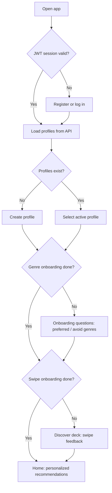
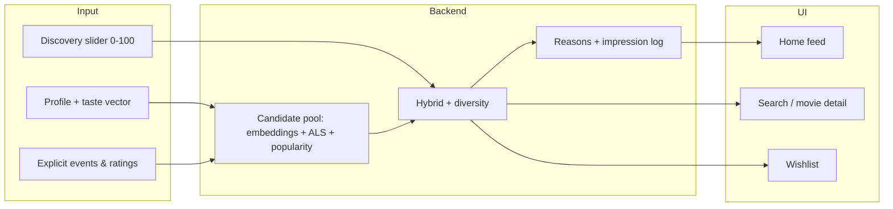
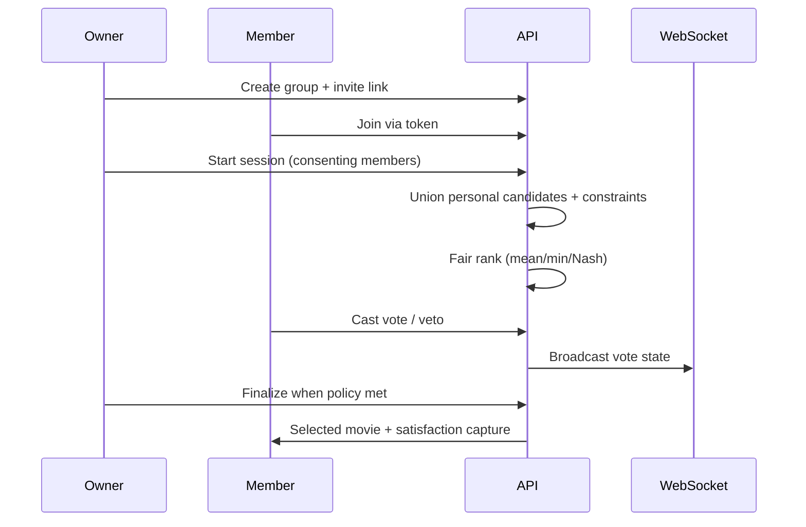

# CineMatch

CineMatch is an end-to-end **movie discovery and recommendation platform** built as a portfolio-grade ML product: a **FastAPI** backend, **React/Vite** frontend, **PostgreSQL + pgvector**, multi-strategy ranking, **group decision-making**, and **governed data/ML contracts** (provenance, eligibility, logging, promotion/rollback).

It is **not** a Netflix clone. It does not stream licensed film libraries, run a global CDN, or optimize for watch-time alone. Instead, it demonstrates how to **design, evaluate, and ship** recommender systems with **explicit user control**, **interpretable signals**, and **fair group sessions**—using reproducible **GroupLens MovieLens** data by default and optional **TMDB** display enrichment.

> **Benchmark note (2026-10-19, MovieLens latest-small):** Popularity led test **NDCG@10 (0.0276)** in the measured offline run; hybrid did not beat that baseline on test. The product still ships hybrid, embeddings, ALS, and bandit infrastructure for learning and experimentation. See [recommender model card](docs/recommender-model-card.md) and [portfolio case study](docs/portfolio-case-study.md).

---

## Table of contents

- [What CineMatch does](#what-cinematch-does)
- [How CineMatch differs from Netflix and typical streaming apps](#how-cinematch-differs-from-netflix-and-typical-streaming-apps)
- [Machine learning and ranking stack](#machine-learning-and-ranking-stack)
- [User flows](#user-flows)
- [System architecture](#system-architecture)
- [Quick start (local)](#quick-start-local)
- [Docker Compose](#docker-compose)
- [Deployment (Render + Neon)](#deployment-render--neon)
- [Data, licenses, and ML eligibility](#data-licenses-and-ml-eligibility)
- [Verification](#verification)
- [Documentation index](#documentation-index)
- [License](#license)

---

## What CineMatch does

| Capability | Description |
|------------|-------------|
| **Accounts & profiles** | JWT auth, refresh cookies, multi-profile households, onboarding genre seeds |
| **Discover / onboarding** | Swipe-style explicit feedback with **separate semantics** (like, dislike, love, skip, watchlist, watched, not interested) |
| **Personal recommendations** | Hybrid ranking from content embeddings, implicit ALS, popularity, novelty, and exploration |
| **Search & browse** | Paginated catalog with genre/year/language/runtime filters |
| **Group movie night** | Invites, consent-aware sessions, fair aggregation, live votes, WebSocket updates, final pick |
| **MLOps hooks** | Versioned artifacts, experiment assignment, bandit shadow mode, promotion/rollback patterns, structured logging |
| **Offline training CLI** | Prepare data, train MF/ALS, embed movies, evaluate baselines, optional TMDB enrich |

---

## How CineMatch differs from Netflix and typical streaming apps

Streaming platforms optimize a **closed loop**: massive catalogs, playback, implicit signals (watch time, completion, skips), and proprietary models at scale. CineMatch targets **transparent ML product design** and **explicit, user-owned preference data**.

| Dimension | Typical streaming (e.g. Netflix-style) | CineMatch |
|-----------|----------------------------------------|-----------|
| **Primary goal** | Maximize engagement/watch time on owned catalog | Teach recommender **lifecycle**: cold start → personalized → group → offline eval |
| **Feedback** | Mostly **implicit** (plays, pauses, abandons) | **Explicit** swipes and ratings with **defined meaning** (watched ≠ liked) |
| **Control** | Limited user-facing controls; opaque ranking | Discovery slider, profile isolation, undo, read-only demo mode |
| **Group watching** | Profiles or “who’s watching” for UX; rarely fair **joint ranking** | **Dedicated group sessions**: normalized member scores, least-misery / Nash-style options, vetoes |
| **Explainability** | Short “Because you watched…” style copy | **Component-level reasons** tied to signals (genre match, exploration, collaborative, compromise) |
| **Catalog** | Licensed streaming rights | **MovieLens + optional TMDB metadata**; no video streaming |
| **ML transparency** | Closed models | **Open stack**: popularity, TF-IDF/content, ST embeddings, PyTorch MF, implicit ALS, LightGBM (gated), VW bandits |
| **Evaluation** | Online A/B at scale | **Documented offline protocol** (chronological splits, NDCG/Recall, honest baseline wins) |
| **Data governance** | Internal policies | **Published ML eligibility** (what may enter features vs display-only TMDB) |
| **Deployment story** | Global CDN, encoders, DRM | **Docker/Compose**, optional **Render + Neon**; ephemeral-disk constraints documented |

CineMatch is best understood as a **recommendation systems lab cast as a product**, not a content distributor.

---

## Machine learning and ranking stack

### 1. Data layer

- **Source:** [GroupLens MovieLens](https://grouplens.org/datasets/movielens/) (`latest-small` default; `32m` opt-in).
- **Storage:** PostgreSQL; **pgvector** for 384-d movie embeddings and taste vectors.
- **Optional display:** TMDB Read API for posters/overview/streaming hints—**display-only** for ML under [data rights](docs/data-rights.md).
- **Provenance:** Dataset fingerprints, feature versions, and event contracts ([ML contracts](docs/ml-contracts.md)).

### 2. Baselines and classical models

| Technique | Role | Implementation notes |
|-----------|------|----------------------|
| **Popularity prior** | Cold start & strong offline baseline | Regularized aggregate rating evidence; default when personalization is weak |
| **Content / TF-IDF** | Item similarity, sparse metadata | Normalized sparse vectors; genre/title features from ML-eligible fields |
| **Explicit matrix factorization** | Rating prediction & latent taste | **PyTorch** user/item factors; CPU `state_dict` load with `weights_only=True` |
| **Item–item similarity** | “More like this” | Genre overlap on catalog |

### 3. Modern personalization

| Technique | Role | Implementation notes |
|-----------|------|----------------------|
| **Sentence Transformer embeddings** | Semantic content similarity | `sentence-transformers` on CPU; **384-d** vectors in pgvector; taste profile = weighted centroid of liked/seed genres |
| **Implicit ALS** | Collaborative filtering from implicit/explicit events | `ImplicitALSRecommender`; confidence-weighted; isolated per app user namespace; artifact load at serve time |
| **Hybrid ranker** | Production-style blending | Weighted **content + collaborative + popularity + exploration**; weights adapt to exploration slider |
| **MMR / diversity** | Reduce redundant recommendations | Diversity parameter on personal API; genre/decade bucketing on discover deck |

### 4. Learning-to-rank and bandits (gated / shadow)

| Technique | Role | Status |
|-----------|------|--------|
| **LightGBM LTR** | Learned re-ranker when enough labeled data | **Minimum-data gated**; not enabled without sufficient interactions |
| **Vowpal Wabbit ADF** | Contextual bandit next-item policy | **Shadow mode by default**; logs propensities; promotion only with evidence vs hybrid |
| **Off-policy evaluation** | IPS/DR-style safeguards | Fails closed without eligible sets and logged propensities |

### 5. Group fairness layer

Not a single ML model—a **multi-objective aggregator** on top of per-member personal scores:

- Per-member score **normalization** so long histories do not dominate.
- **Balanced:** `0.75 × mean + 0.25 × min` member satisfaction.
- **Everyone matters:** `0.25 × mean + 0.75 × min`.
- Custom API weight `w × avg + (1-w) × min`.
- **Fair consensus / Nash** variants for session ranking; **vetoes** session-scoped only.
- Votes and satisfaction **do not silently overwrite** personal profiles.

### 6. Feedback semantics (training-relevant)

Swipe actions are **not** interchangeable:

- **Like / Dislike / Love** → explicit preference events (train taste & hybrid).
- **Watched** → history only; **does not** imply enjoyment.
- **Skip** → no negative label.
- **Wishlist** → intent, weaker positive signal.
- **Undo** → restores last snapshot; idempotent writes with request IDs.

Ratings use MovieLens-style thresholds: ≥4 positive, ≤2.5 negative, 3–3.5 neutral.

### 7. Serving path (personal)

1. Load profile taste vector (pgvector) or rebuild from events/seeds.
2. Build candidate pool from embeddings + optional ALS + popularity + novelty.
3. Apply eligibility filters (dismissed, watched, explicit rejects).
4. Hybrid combine + optional MMR/diversity.
5. Attach **reason strings** and log impressions (request/impression IDs for bandit attribution).
6. Optional VW policy selects among eligible items **after** hybrid pool (shadow unless promoted).

### 8. Offline evaluation (honest metrics)

CLI: `python -m scripts.cli evaluate`

- Chronological holdouts, leakage-safe splits.
- Metrics: Recall@K, Precision@K, NDCG@K, RMSE/MAE (MF), coverage, latency.
- **Popularity won NDCG@10** on the documented latest-small run—reported, not hidden.

---

## User flows

### Authentication and profiles



### Personal discovery and recommendations



### Group movie night



### End-to-end request path (simplified)

```text
Browser (React)
  → REST /api/*  (+ WebSocket for group sessions)
  → FastAPI (auth, catalog, preferences, recommend, groups)
  → PostgreSQL (+ pgvector)
  → Optional: Redis (rate limits only)
  → Artifact volume: ALS, MF, evaluation reports (offline)
```

---

## System architecture

```text
┌─────────────────────────────────────────────────────────────────┐
│                     React / Vite SPA (CDN static)                │
│  Auth · Profiles · Discover · Home · Search · Groups · Settings  │
└────────────────────────────┬────────────────────────────────────┘
                             │ HTTPS  /api
┌────────────────────────────▼────────────────────────────────────┐
│                    FastAPI modular monolith                      │
│  JWT · CORS · rate limits · MLOps · bandit shadow · mail preview │
└────────────────────────────┬────────────────────────────────────┘
                             │
         ┌───────────────────┼───────────────────┐
         ▼                   ▼                   ▼
   PostgreSQL            Artifact dir         Optional Redis
   + pgvector            (MF, ALS, eval)      (rate limit)
         │
   Neon (hosted) or Compose pgvector locally
```

Deep dive: [architecture](docs/architecture.md).

---

## Quick start (local)

**Prerequisites:** Python 3.11, [uv](https://docs.astral.sh/uv/), Node.js 20+, npm, PostgreSQL 17 + pgvector (or Docker).

```bash
cp .env.example .env
docker compose up -d db
uv sync --python 3.11
uv run --python 3.11 python -m scripts.cli prepare --dataset latest-small
uv run --python 3.11 alembic upgrade head
uv run --python 3.11 uvicorn backend.app:app --reload --host 127.0.0.1 --port 8000
```

Second terminal:

```bash
npm --prefix frontend ci
CINEMATCH_BACKEND_URL=http://127.0.0.1:8000 npm --prefix frontend run dev
```

- UI: <http://localhost:5173>
- API docs: <http://localhost:8000/docs>

**Train & evaluate (offline):**

```bash
uv run --python 3.11 python -m scripts.cli prepare --dataset latest-small
uv run --python 3.11 python -m scripts.cli evaluate
uv run --python 3.11 python -m scripts.cli train
uv run --python 3.11 python -m scripts.cli train-als   # implicit ALS artifact
uv run --python 3.11 python -m scripts.cli embed       # Sentence Transformer → pgvector
```

**Optional TMDB enrichment** (posters/metadata; requires token):

```bash
export CINEMATCH_TMDB_TOKEN="your-read-access-token"
uv run --python 3.11 python -m scripts.cli enrich
```

**Import recent TMDB discover titles** (outside MovieLens):

```bash
uv run --python 3.11 python -m scripts.cli import-tmdb-discover --years 3 --limit 500
uv run --python 3.11 python -m scripts.cli embed --force
```

---

## Docker Compose

Full stack (DB, migrations, prepare job, API, frontend):

```bash
cp .env.example .env
docker compose up --build
```

Open <http://localhost:5173>. Volumes persist Postgres data and artifacts under named volumes.

**Make shortcuts:** `make install`, `make dev-backend`, `make dev-frontend`, `make test`, `make compose-up`, `make demo-read-only`.

---

## Deployment (Render + Neon)

This repo includes a **`render.yaml`** Blueprint and a production-oriented **`Dockerfile.backend`** (binds `PORT`, runs Alembic on start).

Typical hosted layout:

| Service | Purpose |
|---------|-----------|
| **Render Web Service** | Docker API (`Dockerfile.backend`) |
| **Render Static Site** | Vite build (`frontend/dist`) |
| **Neon Postgres** | Managed PostgreSQL; set `DATABASE_URL` / `DATABASE_URL_UNPOOLED` on Render |

**Production tips:**

- Set `CINEMATCH_POSTER_LIVE_FETCH=false` on ephemeral hosts to avoid slow per-request poster HTTP.
- Set `CINEMATCH_CORS_ORIGINS` and `CINEMATCH_PUBLIC_APP_URL` to your static site URL.
- Free Render services **spin down** when idle—first load after sleep is slow.
- Catalog/artifacts on Render disk are **not durable** unless you add persistent storage or external object storage.

Details: [deployment guide](docs/deployment.md).

---

## Data, licenses, and ML eligibility

- **MovieLens:** [GroupLens](https://grouplens.org/datasets/movielens/) — attribution and terms apply; see [data.md](docs/data.md).
- **TMDB:** display/metadata only for ML features under current policy; [API terms](https://www.themoviedb.org/documentation/api/terms-of-use).
- **ML eligibility matrix:** [data-rights.md](docs/data-rights.md).
- **Events, features, rewards:** [ml-contracts.md](docs/ml-contracts.md).

Project **source code** is MIT-licensed; **datasets and third-party content are not**.

---

## Verification

Last project verification snapshot: [PROJECT_STATUS.md](PROJECT_STATUS.md).

```bash
uv run --python 3.11 pytest
uv run --python 3.11 ruff check .
uv run --python 3.11 mypy backend recommender
npm --prefix frontend run typecheck
npm --prefix frontend run test
npm --prefix frontend run build
```

---

## Documentation index

| Doc | Contents |
|-----|----------|
| [architecture.md](docs/architecture.md) | Components, personal/group paths, MLOps |
| [recommender-model-card.md](docs/recommender-model-card.md) | Models, limits, evaluation summary |
| [training.md](docs/training.md) | CLI training & artifacts |
| [ml-contracts.md](docs/ml-contracts.md) | Events, features, promotion rules |
| [data-rights.md](docs/data-rights.md) | Field-level ML policy |
| [api.md](docs/api.md) | REST overview |
| [deployment.md](docs/deployment.md) | Local vs hosted constraints |
| [portfolio-case-study.md](docs/portfolio-case-study.md) | Problem, metrics, honest results |
| [demo-script.md](docs/demo-script.md) | 3-minute walkthrough |

---

## License

Source code and project-authored documentation: [MIT License](LICENSE).

Third-party datasets (MovieLens), packages, model weights derived from licensed data, and TMDB content remain under **their respective terms**.
