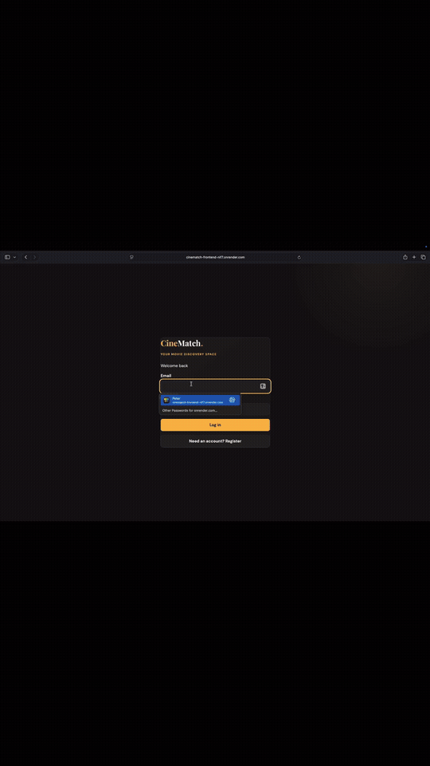
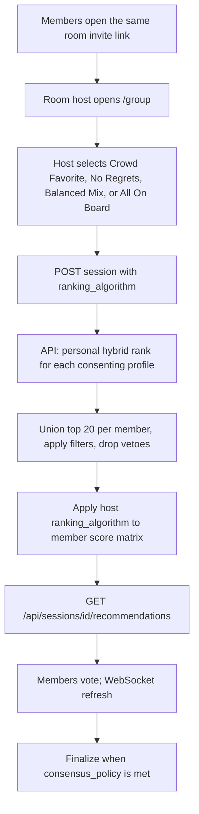
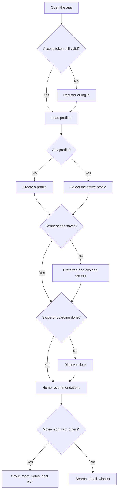
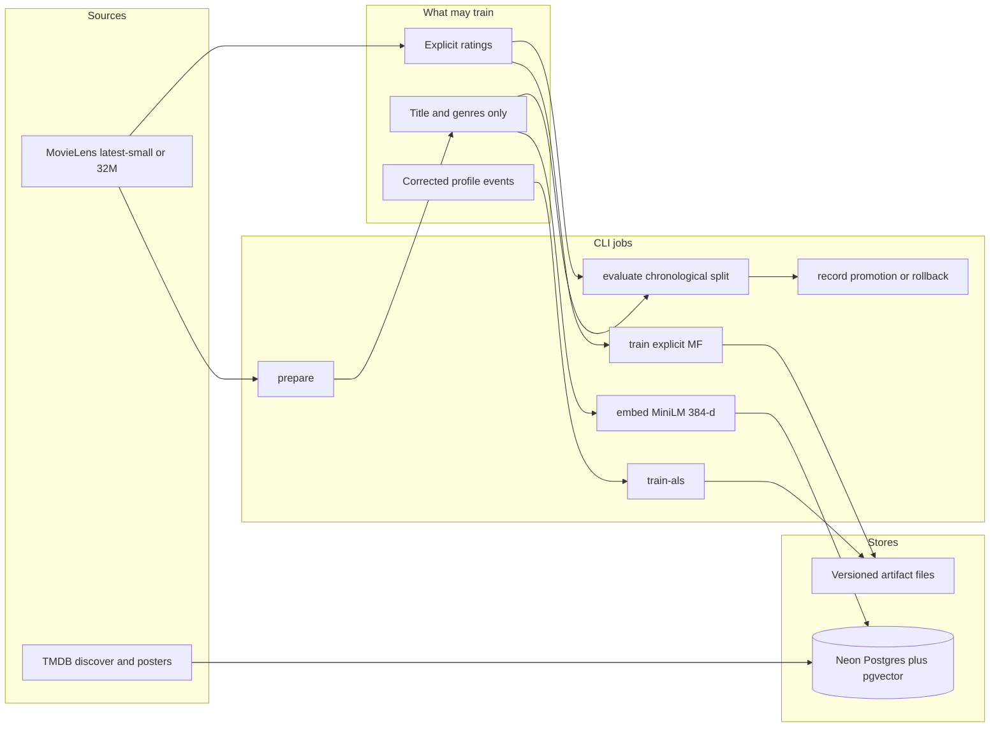
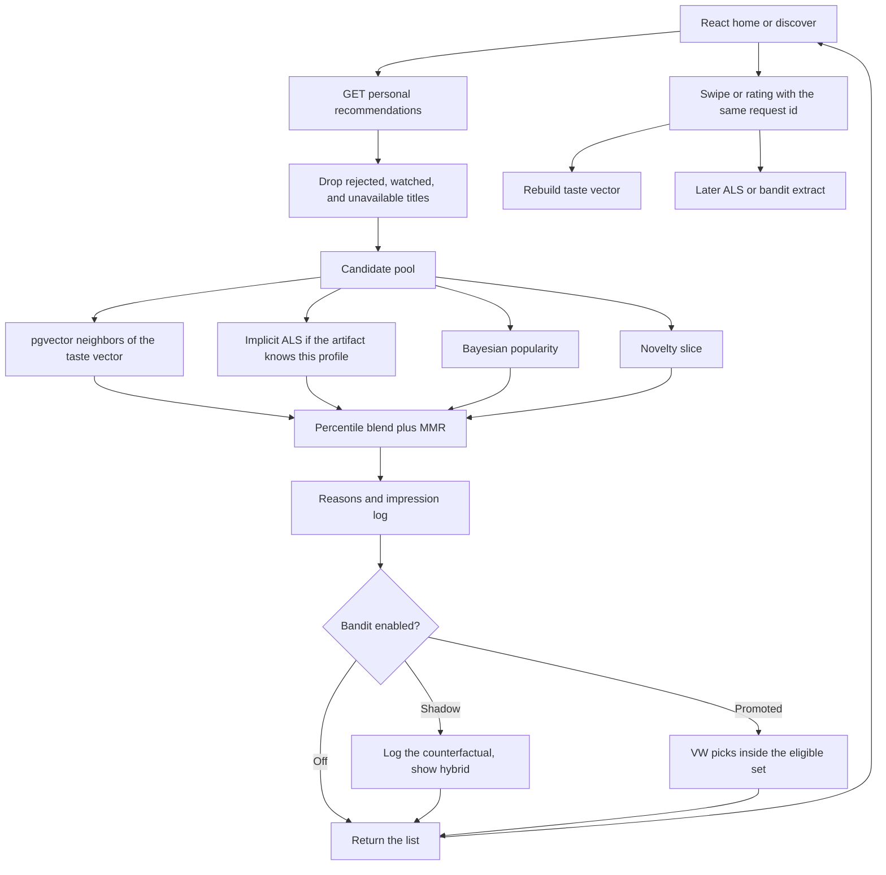
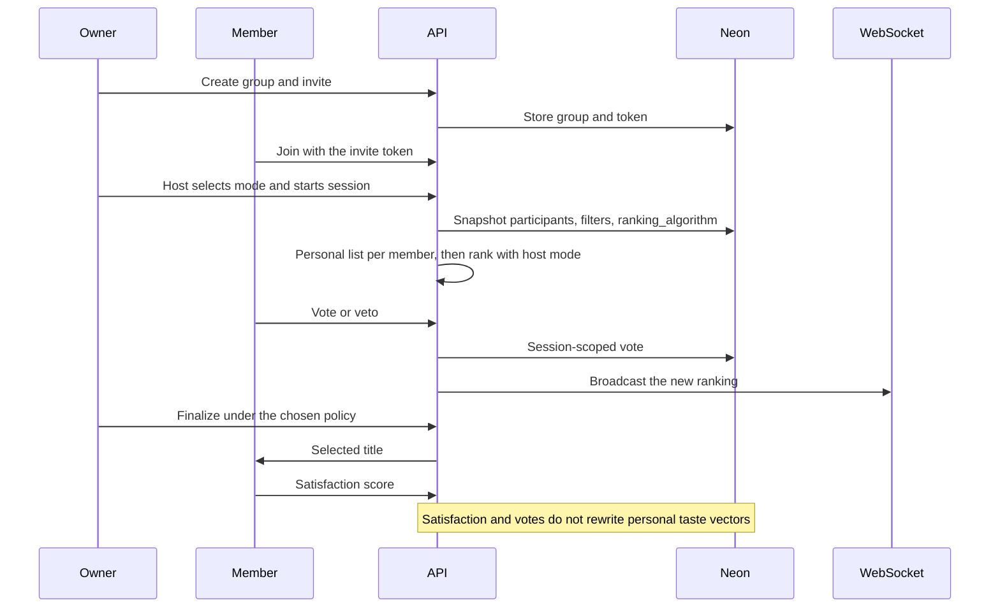
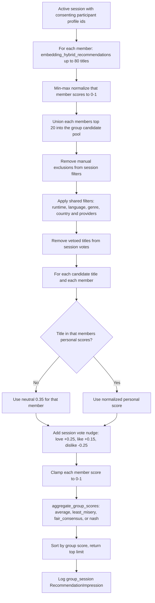
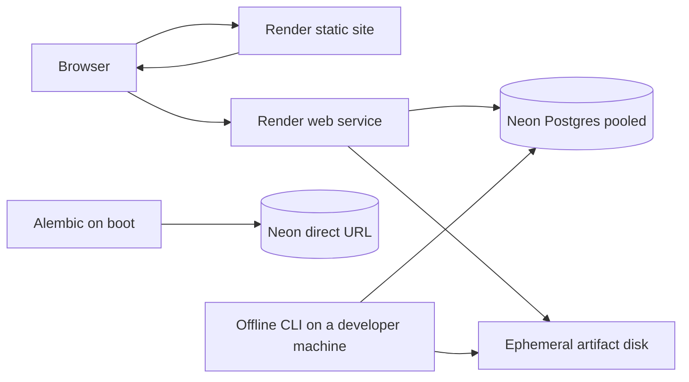
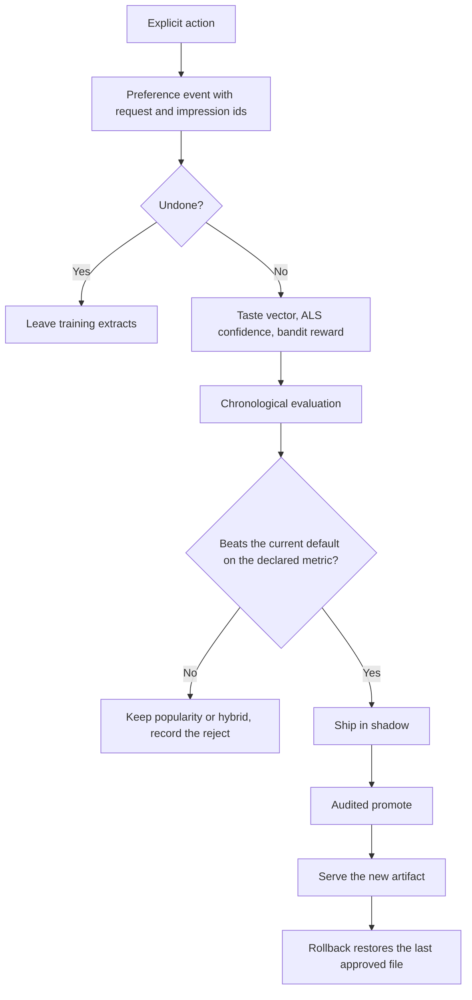

# CineMatch

**Live app:** [cinematch-frontend-nif7.onrender.com](https://cinematch-frontend-nif7.onrender.com) · **API:** [ai-movie-recommenation-system.onrender.com](https://ai-movie-recommenation-system.onrender.com) · **OpenAPI:** [/docs](https://ai-movie-recommenation-system.onrender.com/docs)

Hosted on **[Render](https://render.com)** (web service + static site) · Database on **[Neon Postgres](https://neon.tech)** (pgvector). See [live deployment](#live-deployment) for all links.

CineMatch is a movie **discovery and decision** product. You create a profile, tell it what you like, and it ranks a catalog for you. When several people want to watch together, it ranks a shared shortlist so nobody’s taste is ignored. It does **not** stream films. There is no player, no licensed library, and no watch-time objective.

The system is an end-to-end recommender: a React app, a FastAPI API, **Neon Postgres** (with pgvector) as the database, and **Render** as the host for the API and the static site. Ranking mixes classical baselines, sentence-transformer embeddings, implicit collaborative filtering, a hybrid ranker, and gated learning-to-rank and bandit policies. Every recommendation can say *why* it appeared.

> **Honest benchmark (2026-10-19, MovieLens latest-small).** Popularity won test **NDCG@10 (0.0276)**. Matrix factorization was 0.0234, hybrid 0.0166, content 0.0067. Hybrid weights were chosen on validation only, and popularity stays the measured default. The product still ships the richer stack so cold start, personalization, groups, and offline evaluation can be studied together. Details: [model card](docs/recommender-model-card.md), [case study](docs/portfolio-case-study.md).

---

## Live deployment

Production runs on **Render** (compute + CDN static frontend) with **Neon** as the managed PostgreSQL database when `DATABASE_URL` / `DATABASE_URL_UNPOOLED` are set on the API service. Pushes to `main` trigger Render **autoDeploy** (see [`render.yaml`](render.yaml)).

### URLs (production)

| What | URL |
|------|-----|
| **Web app (start here)** | [https://cinematch-frontend-nif7.onrender.com](https://cinematch-frontend-nif7.onrender.com) |
| **REST API base** | [https://ai-movie-recommenation-system.onrender.com](https://ai-movie-recommenation-system.onrender.com) |
| **API routes (prefix)** | `https://ai-movie-recommenation-system.onrender.com/api` |
| **Interactive API docs** | [https://ai-movie-recommenation-system.onrender.com/docs](https://ai-movie-recommenation-system.onrender.com/docs) |
| **OpenAPI JSON** | [https://ai-movie-recommenation-system.onrender.com/openapi.json](https://ai-movie-recommenation-system.onrender.com/openapi.json) |
| **Health** | [https://ai-movie-recommenation-system.onrender.com/health](https://ai-movie-recommenation-system.onrender.com/health) |
| **Readiness (DB)** | [https://ai-movie-recommenation-system.onrender.com/ready](https://ai-movie-recommenation-system.onrender.com/ready) |

The **static site** build on Render embeds `VITE_API_URL=https://ai-movie-recommenation-system.onrender.com/api` (set in the static site’s environment at build time; it is not in [`render.yaml`](render.yaml), which only defines the Docker API service). For the split layout below, CORS and invite links on the API must use the static site origin: `https://cinematch-frontend-nif7.onrender.com`.

### Platforms

| Platform | Role in CineMatch | Where to go |
|----------|-------------------|-------------|
| **[Render](https://render.com)** | Docker **web service** (`Dockerfile.backend`) for FastAPI; **static site** for the Vite build; optional Blueprint Postgres fallback in `render.yaml` | [Render dashboard](https://dashboard.render.com) · [Web services](https://render.com/docs/web-services) · [Static sites](https://render.com/docs/static-sites) · [Blueprints](https://render.com/docs/infrastructure-as-code) |
| **[Neon](https://neon.tech)** | Managed **Postgres 17** with **pgvector**: accounts, catalog, embeddings, events, groups, votes | [Neon console](https://console.neon.tech) · [Connection pooling](https://neon.tech/docs/connect/connection-pooling) · [pgvector on Neon](https://neon.tech/docs/extensions/pgvector) |

**Neon wiring in this repo:** `backend/config.py` maps `DATABASE_URL` (pooled) and `DATABASE_URL_UNPOOLED` (direct, for Alembic). [`neon.ts`](neon.ts) configures branch TTL for dev branches; app auth is JWT in the API, not Neon Auth.

**Render wiring in this repo:** [`render.yaml`](render.yaml) defines the Docker **API** web service (Frankfurt, free plan), health check `/health`, optional Blueprint Postgres fallback, and production env defaults (posters off, bandit off, BLAS thread limits for the 512 MB free tier). The **static frontend** is a separate Render static site you configure in the dashboard. Free-tier services may **sleep after inactivity**; the first request after sleep can take tens of seconds.

### Demo video

Walkthrough of the hosted app (onboarding, recommendations, group movie night). Script: [docs/demo-script.md](docs/demo-script.md).

**Preview** (loops in the README). Click to open the **full demo on YouTube**:

<p align="center">
  <a href="https://www.youtube.com/watch?v=6vkoj2XnSss">
    
  </a>
</p>

**Full walkthrough:** [Watch on YouTube](https://www.youtube.com/watch?v=6vkoj2XnSss) · [youtu.be/6vkoj2XnSss](https://youtu.be/6vkoj2XnSss)

---

## Table of contents

- [Live deployment](#live-deployment) ([demo video](#demo-video))
- [What the app is](#what-the-app-is)
- [Host movie night modes](#host-movie-night-modes)
- [A session, start to finish](#a-session-start-to-finish)
- [What sets it apart](#what-sets-it-apart)
- [Everything the project uses](#everything-the-project-uses)
- [Machine learning techniques](#machine-learning-techniques)
- [Pipelines](#pipelines)
- [Data, licenses, and what may train a model](#data-licenses-and-what-may-train-a-model)
- [Run it locally](#run-it-locally)
- [Docker Compose](#docker-compose)
- [Deploy: Render for the app, Neon for the database](#deploy-render-for-the-app-neon-for-the-database) (includes [blueprint env defaults](#blueprint-env-defaults-renderyaml))
- [Offline results](#offline-results)
- [API surface](#api-surface)
- [Verification](#verification)
- [Documentation](#documentation)
- [License](#license)

---

## What the app is

CineMatch answers three questions a streaming homepage usually hides:

1. **What should I watch next**, given only the preferences I chose to record?
2. **What should we watch together**, when our tastes disagree?
3. **Why this title**, in terms of the signals that actually scored it?

It is built as one product with two clearly separated paths.

**Personal path.** A household can have several profiles. Each profile has its own taste vector, ratings, swipes, wishlist, and “not interested” list. The home feed, search, and “more like this” all read that profile and nothing else.

**Group path.** An owner creates a room and shares an invite link. Each link opens its own room with its own host. **Only that room’s host** picks how recommendations are combined, then starts movie night for everyone who joined that link. The session runs personal ranking for each member, applies shared filters (runtime, language, genre, country or provider when those rows exist), and merges scores with the host’s chosen mode. Votes and vetoes stay inside the session. Finishing a movie night does not silently rewrite anyone’s personal profile.

Under that product is a normal web stack plus an offline training loop. The browser never trains a model. The API serves ranked lists from Postgres and from versioned artifact files. Training, evaluation, embedding, and promotion run as CLI jobs.

### What you can do in the UI

| Route | What happens |
|-------|----------------|
| Sign in / register | Email and password. Short-lived JWT access token. Refresh token in an HttpOnly cookie. Optional email verification codes when SMTP is set. |
| `/profiles` | Create and switch household profiles. Histories stay separate. |
| `/onboarding/questions` | Pick genres you want and genres to avoid. Those seeds build the first taste vector. |
| `/onboarding` | Swipe deck: like, love, dislike, skip, watchlist, watched, not interested. Each action has a fixed meaning. |
| `/` | Personalized home feed, with a discovery slider that trades familiarity for exploration. |
| `/search` | Paginated catalog. Filter by genre, year, language, and runtime. |
| `/movies/:id` | Detail page, similar titles, and the same explicit actions. |
| `/wishlist` | Saved intent. A weaker positive signal than “love”. |
| `/group` and `/invite/:token` | Rooms, invites, **host picks a movie-night mode**, session start, live votes over WebSocket, vetoes, and a final pick. |
| `/settings` | Account, verification, recommendation reset, read-only demo flag. |

Read-only mode (`CINEMATCH_READ_ONLY=true`) keeps browsing and turns writes off. That is the safe posture for a public demo.

---

## Host movie night modes

Group recommendation is **two layers**:

1. **Personal ML (same for every mode).** For each profile in the room, CineMatch runs `embedding_hybrid_recommendations`: taste vector + pgvector content similarity, optional implicit ALS, popularity, exploration, and MMR. That produces up to **80** titles and a score per movie for that person only.
2. **Host-selected aggregation (the mode).** The room host chooses how those per-person scores become **one ordered list** for the room. This is not a second trained model; it is a social-choice rule stored on the session as `ranking_algorithm`.

### Who chooses, and when

| Role | Can do |
|------|--------|
| **Room host** | Pick a mode on the room card, then **Start with …** to create the session (`POST /api/groups/{group_id}/sessions` with `ranking_algorithm`). |
| **Other members** | Join via invite, vote, veto, and see the active mode on the consensus feed. They cannot change the mode after start. |
| **Group owner (not host of this room)** | May see other rooms for moderation, but cannot start movie night in someone else’s room. |

The UI lives on **`/group` → room card**. Non-hosts see: *Waiting for {host} to choose a recommendation mode and start movie night.*

### The four host options (plain language → API → math)

| What the host sees | API `ranking_algorithm` | Use when | How the group score is computed |
|--------------------|-------------------------|----------|----------------------------------|
| **Crowd Favorite** | `average` | The room already likes similar things; optimize the **average** enjoyment. | `mean(member_scores)` |
| **No Regrets** | `least_misery` | You want to avoid one person hating the pick (maximin-style). | `min(member_scores)` |
| **Balanced Mix** · Recommended | `fair_consensus` | Mixed tastes; default for most movie nights. | `0.55×mean + 0.45×min − 0.10×(max−min)` |
| **All On Board** | `nash` | Everyone should score the title **reasonably well**, not just the majority. | Geometric mean of member scores (floor `1e-6`) |

Before aggregation, each member’s scores are **min–max normalized to [0, 1]**. The candidate pool is the **union of each member’s top 20** personal picks (not “only overlap”). If a title is in the pool but missing from someone’s list, that member gets a **neutral 0.35**, not zero. Session votes adjust that member only: love +0.25, like +0.15, dislike −0.25; **veto** drops the title for this session.

Reason strings on group rows reflect the active mode (for example *Crowd Favorite: strongest average match across the room*).

### End-to-end flow (host → list → votes)



**Ranking mode** (`ranking_algorithm`) orders the shortlist. **Consensus policy** (`consensus_policy`, default `majority`) is a separate knob for when a title becomes the **final** pick after votes. Both are set at session creation; the host UI currently sends `consensus_policy: "majority"` with the chosen `ranking_algorithm`.

Example session body:

```json
{
  "requester_profile_id": 12,
  "room_id": 4,
  "participant_profile_ids": [12, 15, 18],
  "ranking_algorithm": "fair_consensus",
  "consensus_policy": "majority"
}
```

### Quick picker guide

| Your room looks like… | Start with |
|-----------------------|------------|
| Same genre night, similar profiles | **Crowd Favorite** |
| One picky person, or strong dislikes | **No Regrets** |
| Typical friends with different tastes | **Balanced Mix** |
| Everyone must tolerate the winner | **All On Board** |

Implementation: `rank_group_session` in `backend/group_sessions.py`; host enforcement in `create_group_session` in `backend/app.py`. Deeper pipeline steps: [Group recommendation pipeline (ranking)](#group-recommendation-pipeline-ranking) under Pipelines.

---

## A session, start to finish



On the server, a personal request does this:

1. Load the profile’s 384-dimensional taste vector from Postgres, or rebuild it from seeds and events.
2. Drop titles the profile has dismissed, rejected, or already watched when that filter is on.
3. Build a candidate pool from embedding similarity, implicit ALS (if an artifact and a user vector exist), Bayesian popularity, and a novelty slice.
4. Normalize each source to a percentile and blend them. Maximal marginal relevance (MMR) then penalizes near-duplicates.
5. Attach a short reason built from the contributing signals, and log the impression with a request id so later feedback can be tied to that exact list.
6. If the contextual bandit is enabled, it may *shadow* the hybrid choice. It does not replace the shown list until it is explicitly promoted.

---

## What sets it apart

Most consumer movie products optimize a closed catalog they can play. Most class-project recommenders stop at one collaborative-filtering script and a notebook metric. CineMatch sits between those: a usable app whose ranking rules, data rights, and evaluation are written down.

| | Typical streaming app | Social catalog or “where to watch” app | Typical demo recommender | CineMatch |
|--|----------------------|----------------------------------------|--------------------------|-----------|
| Job to be done | Keep you watching | Log films, or find a legal stream | Show that a model runs | Help one person or a group **choose** a film |
| Feedback | Mostly implicit: plays, pauses, completion | Stars and reviews, loosely defined | Clicks or a single rating column | Explicit actions with separate meanings. Watched is not liked. Skip is not dislike. |
| Cold start | Giant logs plus editorial rows | Empty profile until you rate a lot | Often ignored | Genre seeds, popularity prior, content similarity before any collaborative vector exists |
| Groups | “Who’s watching?” profiles, still one ranking | No joint ranking | Rarely modeled | Consenting session, per-member scores, average / least-misery / fair consensus / Nash, vetoes, live votes |
| Why this title | One line of marketing copy | None | A similarity number | Reasons tied to the components that scored the row |
| Catalog rights | Licensed video | Metadata plus links | Often scraped | MovieLens for learning. TMDB for posters and blurbs, **display only** |
| Evaluation | Private online tests | Not a ranking product | One accuracy number on a random split | Chronological holdout, Recall / Precision / NDCG, and a published result where the simple baseline won |
| Learning loop | Always on, opaque | None | Train once | Shadow bandits, propensity logs, IPS / doubly robust checks, audited promote and rollback |
| Where it runs | Global CDN and encoders | Their cloud | A laptop notebook | **Render** serves the API and the site. **Neon** holds the data. Training stays offline. |

The practical differences a user feels:

- **You own the signal.** A swipe is a labeled event, not a guess from how long a trailer played.
- **Households do not share one taste vector.** Switching profile changes the feed.
- **A group pick is a compromise you can name.** The room host picks **Crowd Favorite**, **No Regrets**, **Balanced Mix**, or **All On Board** before movie night starts; the formula is visible, not a hidden blend.
- **The model card admits when personalization loses.** Popularity beat hybrid on the measured MovieLens run. That result is the default story, not a footnote.
- **Display data cannot leak into training.** Overviews, cast, and posters from TMDB never enter the embedding text or the feature policy.

CineMatch is a recommendation-systems product you can click through. It is not a Netflix replacement, and it should not be described as one.

---

## Everything the project uses

### Product surfaces

| Piece | Choice | Role |
|-------|--------|------|
| Web UI | React 19, TypeScript, Vite 7 | Single-page app: auth, profiles, discover, search, groups, settings |
| Styling and motion | Tailwind CSS 4, Motion | Layout and swipe / list animation |
| Client data | TanStack Query, React Router 7 | Server state and routes |
| API | FastAPI 0.146, Uvicorn, Pydantic 2 | JSON API, OpenAPI at `/docs`, one WebSocket for group sessions |
| Auth | PyJWT, Argon2 (`argon2-cffi`) | Access tokens in memory, refresh tokens hashed at rest, HttpOnly cookie |
| Mail | SMTP via the standard library path in `backend/mail.py` | Optional verification codes. Blank SMTP shows the code in settings during local dev. |
| ORM and migrations | SQLAlchemy 2.1, Alembic | Schema lives in Postgres. SQLite is only a migration smoke target. |
| Database driver | psycopg 3 | SQLAlchemy URL form `postgresql+psycopg://` |
| Vectors | pgvector (`Vector(384)`) | Movie embeddings and per-profile taste vectors |
| Production database | **Neon Postgres** | Pooled URL for the API, direct URL for Alembic. See [deploy](#deploy-render-for-the-app-neon-for-the-database). |
| Production compute | **Render** | Docker web service for the API, static site for the Vite build |
| Local database | `pgvector/pgvector:pg17` in Compose | Same schema as Neon, on your machine |
| Optional cache | Redis 8 | Shared rate-limit store when more than one API instance is running. Unused if `CINEMATCH_REDIS_URL` is empty. |
| Catalog display | TMDB Read API (`httpx`) | Posters, overviews, discover import. Not an ML feature source. |
| Language and packaging | Python 3.11, [uv](https://docs.astral.sh/uv/), Node 20+ | Locked with `uv.lock` and `frontend/package-lock.json` |
| Tests | pytest, Ruff, mypy, Vitest, Testing Library, Playwright | API, recommenders, UI unit tests, one browser journey |
| CI | GitHub Actions | Postgres 17 + pgvector service, backend checks, frontend checks, `docker compose build` |
| Containers | `Dockerfile.backend`, `frontend/Dockerfile`, `compose.yaml` | API image binds `0.0.0.0:$PORT` and runs migrations on start |

Neon Auth, Neon Functions, and Neon Object Storage are **not** used. Accounts, files, and background work stay in this repo’s API. `neon.ts` only sets branch policy for the Neon project (new non-default branches expire after 7 days).

### Python libraries that do the learning

| Library | Used for |
|---------|----------|
| NumPy, pandas, SciPy | Tables, sparse matrices, vector math |
| scikit-learn | TF-IDF content vectors |
| PyTorch (CPU wheel on Linux) | Explicit matrix factorization |
| `implicit` | Alternating least squares on implicit feedback |
| `sentence-transformers` | `all-MiniLM-L6-v2` movie and taste embeddings |
| LightGBM | LambdaRank re-ranker, refused until a data gate passes |
| Vowpal Wabbit | Action-dependent-feature contextual bandit |
| Typer | `python -m scripts.cli` training and data commands |

### Configuration that matters in production

| Variable | Meaning |
|----------|---------|
| `DATABASE_URL` | Neon **pooled** connection. The API uses this when `CINEMATCH_DATABASE_URL` is unset. |
| `DATABASE_URL_UNPOOLED` | Neon **direct** connection. Alembic uses this so migrations are not sent through the pooler. |
| `CINEMATCH_DATABASE_URL` | Explicit override. Wins over the Neon pooled URL. Compose sets this to the local Postgres service. |
| `CINEMATCH_CORS_ORIGINS` | Browser origins allowed to call the API. **Split layout:** the static site origin (e.g. `https://cinematch-frontend-nif7.onrender.com`). **Same-origin:** the API origin if `frontend/dist` is served from the Docker web service. |
| `CINEMATCH_PUBLIC_APP_URL` | Public site URL used in invite links. Match the URL users open in the browser (usually the static site in production). |
| `CINEMATCH_JWT_SECRET` | At least 32 random bytes. Generated in the Render blueprint. |
| `CINEMATCH_SECURE_COOKIES` | `true` on Render so the refresh cookie is HTTPS-only. |
| `CINEMATCH_POSTER_LIVE_FETCH` | Set `false` on Render. Avoids slow Wikipedia/TMDB HTTP on each page; ephemeral disk cannot hold a durable poster cache. |
| `CINEMATCH_POSTER_LOOKUP` | Set `false` on Render. Skips the startup background job that scans the catalog for missing posters (saves RAM and outbound HTTP). Posters already stored on `Movie.poster_path` in Neon still display. |
| `CINEMATCH_TMDB_TOKEN` | Optional. Never baked into the image. |
| `CINEMATCH_BANDIT_ENABLED` / `CINEMATCH_BANDIT_SHADOW` | Bandit off unless enabled (`false` in [`render.yaml`](render.yaml)). Shadow stays on until a promotion decision. |
| `OMP_NUM_THREADS`, `OPENBLAS_NUM_THREADS`, `MKL_NUM_THREADS` | Set to `1` on Render free tier so NumPy/SciPy do not spawn extra threads inside a 512 MB container ([`render.yaml`](render.yaml)). |
| `VITE_API_URL` | Baked into the static build. Production value is the Render API origin plus `/api`. |

The settings layer rewrites Neon URLs for psycopg: it forces `sslmode=require` and strips `channel_binding`, which the Neon pooler string sometimes includes.

---

## Machine learning techniques

Training is offline and CPU-friendly. Serving reads artifacts and vectors. If an artifact is missing, the API falls back to the next simpler signal and says so.

### 1. Bayesian popularity

`BayesianPopularity` shrinks each movie’s mean rating toward the global mean with a prior of **20 votes**:

```text
score = (votes × movie_mean + 20 × global_mean) / (votes + 20)
```

This is the cold-start list and the strongest offline ranker on latest-small. A brand-new profile sees this list, labeled as popular in the dataset, until seeds and swipes exist.

### 2. Content similarity (TF-IDF)

`TfidfVectorizer` builds unigrams and bigrams from **title + genres only**, capped at 20,000 features. A policy file (`configs/data_sources.json`) refuses any other field. Item–item cosine neighbors power “more like this” when no embedding row exists yet.

### 3. Explicit matrix factorization (PyTorch)

`ExplicitMF` predicts a rating as:

```text
global_mean + user_bias + item_bias + dot(user_factors, item_factors)
```

Defaults in `configs/default.json`: **32 factors**, 30 epochs, batch 1024, learning rate 0.01, weight decay `1e-5`, early stopping patience 4, seed 42. Factors are stored as a PyTorch `state_dict` and loaded with `weights_only=True`. On the measured run, RMSE was **0.9884** and MAE **0.7643**. A lower rating error did not produce a better top-10 than popularity.

### 4. Sentence-transformer embeddings

`sentence-transformers/all-MiniLM-L6-v2` encodes the same ML-eligible text (title and genres) into **L2-normalized 384-d** vectors on CPU. Rows land in `movie_embeddings`. Unchanged movies are skipped. The model card for MiniLM is Apache-2.0; the MovieLens text it reads is still under GroupLens terms.

A profile taste vector is a **weighted centroid** of those movie vectors:

| Signal | Weight in the taste centroid |
|--------|------------------------------|
| Love | 1.5 |
| Like | 1.0 |
| Watchlist | 0.35 |
| Watched, skip | 0 |
| Dislike, not interested | −1.0 |
| Onboarding genre you want | pulls the centroid toward popular embeddings in that genre |
| Onboarding genre you avoid | pushes away |

Nearest neighbors in pgvector are the content candidates at request time. New titles can be recommended as soon as they are embedded, with no ALS retrain.

### 5. Implicit ALS

`ImplicitALSRecommender` (`implicit`’s CPU ALS) factorizes a confidence matrix. Defaults: **32 factors**, 20 iterations, regularization 0.05.

| Action | ALS confidence |
|--------|----------------|
| Love | +5 |
| Like | +3 |
| Watchlist | +1 |
| Dislike, not interested | −2 |
| Watched, skip | dropped (zero confidence) |

Application users are keyed as `app:{id}` and MovieLens users as `movielens:{id}`, so the two namespaces cannot collide. If the artifact, the user, or the item is missing, serving drops this source and keeps content plus popularity.

### 6. Hybrid ranker and MMR

`HybridRecommender` percentile-normalizes each source, then blends. Two weight sets exist, and they answer different questions.

**Offline benchmark** (`configs/default.json`), the blend that was measured against popularity: popularity **0.20**, content **0.35**, matrix factorization **0.45**, MMR diversity **0.15**. This is the hybrid row in the results table. It did not beat popularity.

**Live personal feed** (`embedding_hybrid_recommendations`), once a taste vector exists. With the default exploration of 0.15:

| Source | Weight | What it is |
|--------|--------|------------|
| Content | `max(0.35, 0.55 − 0.2 × exploration)` → **0.52** | Cosine between the taste vector and the movie embedding |
| Collaborative | **0.25** if an ALS artifact is loaded, else **0** | Implicit ALS for `app:{profile}` |
| Popularity | **0.20** | Min-max of the catalog popularity score inside the candidate pool |
| Exploration | `max(0.05, exploration)` → **0.15** | `1 − popularity`, so less familiar titles can enter |

Raising the discovery slider increases the exploration weight and trims the content weight. MMR diversity on this path defaults to **0.18**:

```text
objective = (1 − diversity) × relevance − diversity × max cosine to already picked items
```

Cosine uses the candidate’s embedding when one exists, so the list does not fill with five near-duplicate action films. A profile with no taste vector skips this blend and uses the simpler profile recommender (popularity and content, with the same discovery control).

### 7. LightGBM learning-to-rank (gated)

`LGBMRanker` with objective `lambdarank` and metric NDCG. It **refuses to train** unless the frame has at least **1,000 rows**, **100 users**, and **100 positive labels**, and a chronological 80/20 validation slice is non-empty. Latest-small personal traffic in a demo will not open this gate. That is intentional: a ranker fit on a handful of swipes would look smarter than it is.

### 8. Vowpal Wabbit contextual bandit (shadow)

Action-dependent features (ADF), policy version `vw-adf-epsilon-v1`, epsilon **0.1**. The policy sees only items that already passed safety and availability filters. Rewards: love +1.5, like +1, watchlist +0.35, dislike and not interested −1, watched and skip 0. Learning uses `cost = −reward` and checkpoints `artifacts/vw/policy.model` atomically.

`CINEMATCH_BANDIT_SHADOW=true` by default. Shadow decisions are logged as counterfactuals. They do not change the movies on screen and they do not train the policy. Promotion requires a comparison against the hybrid and an audited row. A missing or corrupt policy file falls back to hybrid.

### 9. Off-policy checks

Inverse propensity scoring and doubly robust scoring run only when every row has a reward, a logging probability in `(0, 1)`, a target probability, and a non-empty eligible set. Missing propensities raise. Organic clicks and old rows without an eligible set are excluded. Weights are capped at 100.

### 10. Group ranking (not another embedding model)

Each member gets their own personal candidate list. Scores are min-max normalized so a profile with a long history cannot dominate by raw magnitude. Missing movies receive a neutral **0.35** so a title only one person knows is not treated as hatred. Live votes then nudge that member’s score: love +0.25, like +0.15, dislike −0.25. A veto removes the title from **this session only**.

The room host chooses one plain-language mode before starting movie night. The choice is stored on the session and changes the group-scoring formula:

| Host option | Algorithm | Best for | Score |
|-------------|-----------|----------|-------|
| **Crowd Favorite** | Average | A room that already has similar tastes | mean of member scores |
| **No Regrets** | Least misery | Making sure nobody is stuck with a strongly disliked choice | minimum member score |
| **Balanced Mix** (recommended default) | Fair consensus | Mixed tastes and a practical compromise | `0.55 × mean + 0.45 × min − 0.10 × (max − min)` |
| **All On Board** | Nash | Requiring every member to score the choice reasonably well | geometric mean, with a floor of `1e-6` so a zero cannot wipe the product |

Only the room host can select the mode and start that room's session. Participants see the active mode above the consensus feed. The personal recommender is unchanged: it still calculates a separate ML score for every member. The selected mode controls how those per-member predictions become one group score; it is an aggregation policy, not four separately trained models.

Reasons are template sentences from the spread: strong agreement, a compromise with no low score, or an explicit balance of the average and the least-satisfied member.

### How a label is born

Ratings follow MovieLens convention: **≥ 4** positive, **≤ 2.5** negative, **3 to 3.5** neutral. Swipes are not ratings and are not interchangeable. Undo restores the previous snapshot and marks the event undone so it leaves the taste centroid and the ALS extract.

---

## Pipelines

### Offline data and training



TMDB rows are written for the UI. The embed job never reads overview, cast, crew, keywords, or images.

Commands:

```bash
uv run --python 3.11 python -m scripts.cli prepare --dataset latest-small
uv run --python 3.11 python -m scripts.cli embed
uv run --python 3.11 python -m scripts.cli train
uv run --python 3.11 python -m scripts.cli train-collaborative
uv run --python 3.11 python -m scripts.cli evaluate
```

Optional catalog growth (display metadata, then re-embed from title and genres):

```bash
export CINEMATCH_TMDB_TOKEN="your-read-access-token"
uv run --python 3.11 python -m scripts.cli enrich
uv run --python 3.11 python -m scripts.cli import-tmdb-discover --years 3 --limit 500
uv run --python 3.11 python -m scripts.cli embed --force
```

### Online personal ranking



### Group movie night



There is **no separate “group model.”** Group recommendation is **personal ranking for each member**, then **social-choice aggregation** on a shared candidate pool. Implementation: `rank_group_session` in `backend/group_sessions.py`, served at `GET /api/sessions/{session_id}/recommendations`.

#### Group recommendation pipeline (ranking)



Step-by-step:

| Step | What happens |
|------|----------------|
| **1. Consent and snapshot** | Session stores `participant_profile_ids` only from group members who opted in to use personal preferences. Optional room scope further limits who can start or join. |
| **2. Personal lists** | Each participant gets the same **embedding hybrid** path as home (taste vector, content, optional ALS, popularity, exploration, MMR), up to **80** movies. |
| **3. Per-member normalization** | Raw scores are **min–max scaled to [0, 1]** so one long history cannot dominate by magnitude alone. |
| **4. Candidate pool** | Pool = **union of each member’s top 20** (not intersection). Minority tastes can enter because the pool is not “only what everyone’s top 80 shared.” |
| **5. Shared constraints** | Session `filters` drop titles by max runtime, language, genre, country/provider availability, and explicit `exclusions`. |
| **6. Session votes** | **Veto** removes a title from this session only. **Like / love / dislike** adjust that member’s score for that title (+0.15 / +0.25 / −0.25). Missing titles for a member use **0.35**, not zero. |
| **7. Group score** | One vector of member scores → single rank via the session’s `ranking_algorithm` (see [§10 Group ranking](#10-group-ranking-not-another-embedding-model)). Default: **fair consensus**. |
| **8. Serve and refresh** | UI loads the sorted list; votes over **WebSocket** trigger a re-fetch so the list moves with the room. Votes do **not** update personal taste vectors or ALS. |

**Ranking vs finalization (two different knobs):**

| Knob | Purpose | Options |
|------|---------|---------|
| **`ranking_algorithm`** | Orders the shared shortlist | `average`, `least_misery`, `fair_consensus`, `nash` |
| **`consensus_policy`** | Decides when a title is the **final pick** after everyone voted | `majority`, `strong` (≥75% like/love), `unanimous`, `veto` |

Finalization uses `consensus_reached`: required votes present, no vetoes on that title, enough positive votes for the policy. Membership changes bump `participant_set_version` so an old ballot cannot decide for a new roster.

**Legacy stateless API:** `POST /api/recommendations/group` with multiple `profile_ids` uses the older **`recommend_for_profile`** ranker over a filtered catalog and blends with **`0.75 × mean + 0.25 × min`** only. No session, votes, vetoes, or WebSocket. Prefer group **sessions** for the full pipeline above.

### Request path in production



Render runs the API. Neon holds accounts, movies, embeddings, events, groups, votes, and audit rows. Model files (MF, ALS, VW) live on the API disk, which **disappears on redeploy** unless you add a Render persistent disk or rebuild artifacts after boot. Treat Neon as the durable store. Treat artifacts as a versioned cache you can retrain.

### Feedback loop and promotion



Retrain when eligible corrected events accumulate, when quality drops, or when features drift. There is no calendar cron that retrains because a week passed.

---

## Data, licenses, and what may train a model

| Source | Used for | May enter a model? |
|--------|----------|--------------------|
| MovieLens latest-small (default) or 32M (opt-in) | Catalog ids, titles, genres, ratings | Yes, under GroupLens terms. Cite GroupLens. Do not imply endorsement. |
| Profile swipes, ratings, seeds | Taste vectors, ALS, bandit rewards | Yes, after undo filtering |
| TMDB overview, images, cast, providers | Posters and detail pages | **No.** Display only. |
| Group votes and vetoes | That session’s ranking | **No** automatic copy into the personal profile |

Latest-small in the published run: **100,836 ratings**, **9,742 movies**, fingerprint `f99049f327bee630ea3d2a7e5be3ec494be7199977593032da402d18d266ee19`.

This product uses the TMDB API but is not endorsed or certified by TMDB.

Field-level rules: [data-rights.md](docs/data-rights.md). Event and feature contracts: [ml-contracts.md](docs/ml-contracts.md). Dataset citation: [data.md](docs/data.md).

Project source code is MIT. Datasets, TMDB content, and model weights derived from MovieLens are not.

---

## Run it locally

**Prerequisites:** Python 3.11, uv, Node.js 20+, npm, and either Docker or PostgreSQL 17 with pgvector.

```bash
cp .env.example .env
docker compose up -d db
uv sync --python 3.11
uv run --python 3.11 python -m scripts.cli prepare --dataset latest-small
uv run --python 3.11 alembic upgrade head
uv run --python 3.11 uvicorn backend.app:app --reload --host 127.0.0.1 --port 8000
```

Second terminal:

```bash
npm --prefix frontend ci
CINEMATCH_BACKEND_URL=http://127.0.0.1:8000 npm --prefix frontend run dev
```

- UI: <http://localhost:5173>
- API docs: <http://localhost:8000/docs>
- Health: <http://localhost:8000/health>

Point `.env` at a Neon branch instead of Compose by leaving `CINEMATCH_DATABASE_URL` unset and setting `DATABASE_URL` plus `DATABASE_URL_UNPOOLED` from the Neon dashboard or `neon deploy`. Enable the `vector` extension on that branch before `alembic upgrade head`.

---

## Docker Compose

Compose is the full local stack: Postgres 17 + pgvector, a one-shot MovieLens prepare, the API, and the frontend.

```bash
cp .env.example .env
docker compose up --build
```

Open <http://localhost:5173>. Named volumes keep Postgres data, downloaded MovieLens files, and artifacts. `docker compose down` keeps them. `docker compose down --volumes` deletes them.

Redis is behind the `shared-cache` profile and is off unless you opt in.

Make targets: `make install`, `make dev-backend`, `make dev-frontend`, `make test`, `make compose-up`, `make demo-read-only`.

---

## Deploy: Render for the app, Neon for the database

Production is two Render services and one Neon database.

| Service | Where | What it runs |
|---------|--------|----------------|
| API | Render web service, Docker, free plan, Frankfurt in `render.yaml` | `Dockerfile.backend`. On boot: `alembic upgrade head`, then Uvicorn on `0.0.0.0:$PORT`. Health check: `/health`. |
| Site | Render static site | `npm ci` and `npm run build` in `frontend/`. Publishes `frontend/dist`. SPA rewrite sends every path to `index.html`. |
| Database | **Neon Postgres** | Accounts, catalog, 384-d vectors, events, groups, votes, model-promotion audit. Pooled connections for requests. Direct connections for migrations. |

Production URLs match [Live deployment](#live-deployment):

- **Web app:** [https://cinematch-frontend-nif7.onrender.com](https://cinematch-frontend-nif7.onrender.com)
- **API:** [https://ai-movie-recommenation-system.onrender.com](https://ai-movie-recommenation-system.onrender.com)

`VITE_API_URL` is compiled into the static site, so changing the API host means a frontend rebuild on Render.

### How the API finds Neon

1. Neon (or `neon deploy`) injects `DATABASE_URL` (pooler host, usually `-pooler` in the hostname) and `DATABASE_URL_UNPOOLED` (direct host).
2. If `CINEMATCH_DATABASE_URL` is missing, `backend/config.py` copies the pooled URL into the runtime engine and the direct URL into the migration engine.
3. Both URLs gain `sslmode=require`. `channel_binding` is removed so psycopg can connect.
4. The process listens on Render’s `PORT`. Local Compose still defaults to 8000.

Create the `vector` extension on the Neon branch once. Alembic’s embedding migration expects it.

`neon.ts` does not provision the Render services. It tells the Neon CLI how branches behave: the default branch is unchanged, and a **new** non-default branch expires after 7 days. Application login is this repo’s JWT, not Neon Auth (`auth: false`).

### Render behavior you should plan for

- Free web services spin down after about 15 minutes idle. The first request after sleep is slow.
- Free web services have about **512 MB RAM**. The Docker image includes PyTorch, `implicit`, and SciPy even though serving mostly uses embeddings from Neon and NumPy paths. After boot, memory metrics often sit **high but stable**; that is normal if `/health` stays up and logs show no `OOM` / `Killed`. For comfortable headroom, upgrade the web service plan or slim the production image (future work). [`render.yaml`](render.yaml) already sets poster/bandit flags off and `OMP_NUM_THREADS=1` (and related vars) to reduce baseline use.
- The container filesystem is ephemeral. `/app/data` and `/app/artifacts` are empty after a new deploy. Movie rows and taste vectors survive because they are in Neon. ALS, MF, and VW files do not, unless you attach a [Render persistent disk](https://render.com/docs/disks) (single instance) or retrain after boot.
- **Posters on Render:** set `CINEMATCH_POSTER_LIVE_FETCH=false` and `CINEMATCH_POSTER_LOOKUP=false` (both defaulted in [`render.yaml`](render.yaml)).
- **CORS and invites:** for the split production layout ([static site](#urls-production) + API), set `CINEMATCH_CORS_ORIGINS` and `CINEMATCH_PUBLIC_APP_URL` to the **static site** origin on the API service (dashboard overrides beat a blueprint that still points at the API hostname). Set `CINEMATCH_SECURE_COOKIES=true`.
- Keep `CINEMATCH_TMDB_TOKEN` and `CINEMATCH_JWT_SECRET` in Render’s secret store. The blueprint generates the JWT secret and leaves the TMDB token for you to paste (`sync: false`).
- One application per service. The API and the site are separate Render services on purpose.
- Train offline. Do not run `train` or `embed` inside the web service request path.

### Blueprint env defaults (`render.yaml`)

The checked-in blueprint sets these on the API web service (override in the dashboard when production URLs differ):

| Variable | Blueprint value | Why |
|----------|-----------------|-----|
| `CINEMATCH_POSTER_LIVE_FETCH` | `false` | No live poster HTTP on ephemeral disk |
| `CINEMATCH_POSTER_LOOKUP` | `false` | No startup catalog poster backfill |
| `CINEMATCH_BANDIT_ENABLED` | `false` | Avoid loading VW at boot without artifacts |
| `OMP_NUM_THREADS` / `OPENBLAS_NUM_THREADS` / `MKL_NUM_THREADS` | `1` | Limit BLAS threading in small containers |
| `CINEMATCH_CORS_ORIGINS` / `CINEMATCH_PUBLIC_APP_URL` | API hostname | Same-origin demo; **change to the static site URL** for split production |

`render.yaml` still declares a Render Postgres instance named `cinematch-db` and wires its connection string into the API. That block is a blueprint fallback. For the Neon layout, set `DATABASE_URL` and `DATABASE_URL_UNPOOLED` on the web service and do not point `CINEMATCH_DATABASE_URL` at the Render database. The app will use Neon.

More hosting constraints: [deployment.md](docs/deployment.md).

---

## Offline results

Protocol for the 2026-10-19 CPU run: MovieLens latest-small, seed 42, per-user chronological leave-last-two-out, validation before test, rating ≥ 4 as a positive, full-catalog candidates, training-seen items excluded. **363 users**, 363 positive held-out interactions.

| Strategy | Recall@10 | Precision@10 | NDCG@10 | Notes |
|----------|-----------|--------------|---------|--------|
| Popularity | 0.0523 | 0.0052 | **0.0276** | Active default from this run |
| Explicit MF | 0.0413 | — | 0.0234 | RMSE 0.9884, MAE 0.7643 |
| Hybrid | 0.0331 | — | 0.0166 | Weights chosen on validation only |
| Content TF-IDF | 0.0110 | 0.0011 | 0.0067 | Title and genre text |

Warm single-user p95 latency was about **0.99 ms** (popularity) to **2.38 ms** (hybrid) in that offline harness. Those numbers are in-process ranking, not Render cold-start time.

Regenerate the report with `python -m scripts.cli evaluate`. Artifacts are gitignored because they are derived from MovieLens.

---

## API surface

Interactive contract: `/docs` and `/openapi.json` on the API host.

| Area | Endpoints |
|------|-----------|
| Health | `GET /health`, `GET /ready`, `GET /api/health/models`, `GET /api/settings` |
| Auth | `POST /api/auth/register`, `/login`, `/refresh`, `/logout` |
| Account | `GET/PATCH/DELETE /api/users/me`, verification issue and confirm, legacy profile claim |
| Profiles | `POST/GET /api/profiles`, onboarding preferences |
| Catalog | `GET /api/movies`, `GET /api/movies/{id}`, `GET /api/movies/{id}/similar` |
| Feedback | Ratings, typed interactions, wishlist, preference list, recommendation reset |
| Personal rank | `GET /api/profiles/{id}/recommendations`, `GET /api/recommendations/personal`, discover deck |
| Groups | Create group, invites, join by token, rooms, sessions, votes, recommendations, finalize, satisfaction |
| Live | `WS /api/sessions/{id}/ws` |
| Ops | `GET /api/models` for recorded runs |

Writes send `Authorization: Bearer <access-token>`. Recommendation payloads include request and impression ids. Feedback that claims to be about a recommendation must echo those ids.

---

## Verification

Latest snapshot: [PROJECT_STATUS.md](PROJECT_STATUS.md) (2026-10-26). At that date: pytest 37 passed, Ruff and mypy clean, Vitest 4 passed, frontend typecheck and production build passed, Alembic upgrade on Postgres 17 + pgvector, Compose config valid.

```bash
uv run --python 3.11 pytest
uv run --python 3.11 ruff check .
uv run --python 3.11 mypy backend recommender
npm --prefix frontend run typecheck
npm --prefix frontend run test
npm --prefix frontend run build
```

CI (`.github/workflows/ci.yml`) repeats the backend checks against a `pgvector/pgvector:pg17` service, the frontend checks, and `docker compose build`.

---

## Documentation

| Doc | Contents |
|-----|----------|
| [architecture.md](docs/architecture.md) | Serving paths, identity boundaries, MLOps |
| [recommender-model-card.md](docs/recommender-model-card.md) | Intended use, cold start, limits |
| [training.md](docs/training.md) | CLI, bandit flags, promotion |
| [ml-contracts.md](docs/ml-contracts.md) | Events, features, rewards |
| [data-rights.md](docs/data-rights.md) | Which fields may train |
| [data.md](docs/data.md) | MovieLens and TMDB attribution |
| [api.md](docs/api.md) | Route overview |
| [deployment.md](docs/deployment.md) | Local, Compose, and host constraints |
| [portfolio-case-study.md](docs/portfolio-case-study.md) | Problem, protocol, numbers |
| [demo-script.md](docs/demo-script.md) | Short walkthrough |

---

## License

Source code and project-authored documentation: [MIT License](LICENSE).

MovieLens remains under GroupLens terms. TMDB content remains under TMDB’s API terms. Package licenses and the MiniLM model license stay with those projects.
